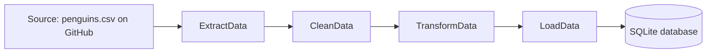

# Data Pipeline with Luigi

## Overview
A small ETL pipeline that collects the Palmer Penguins dataset from the web, cleans it, creates new features, and loads the result into a SQLite database. The steps are orchestrated with Luigi, so the whole process runs with one command.

## Architecture

| Task | Input | Output | What it does |
|---|---|---|---|
| ExtractData | CSV link | data/pipeline/raw.csv | Downloads the raw data (344 rows, 7 columns) |
| CleanData | raw.csv | data/pipeline/clean.csv | Removes duplicates and rows with no measurements, tidies sex labels, fills missing sex with "Unknown" (344 to 342 rows) |
| TransformData | clean.csv | data/pipeline/features.csv | Adds body_mass_kg, bill_ratio, and size_group (10 columns) |
| LoadData | features.csv | data/pipeline/pipeline.db | Loads the table penguins_clean into SQLite |

## How Luigi Orchestrates the Pipeline
Each step is a Luigi Task that declares its dependency (requires) and its output file (output). Running the last task makes Luigi run all earlier tasks in order. If a task's output file already exists, Luigi skips it, so reruns are fast and a failed run resumes from where it stopped. Delete the data/pipeline folder to run everything again.

## How to Run
1. pip install -r requirements.txt
2. python pipeline.py
3. Check the result: open data/pipeline/pipeline.db and query the table penguins_clean.

A screenshot of a successful run is in docs/pipeline_run.png.

## Limitations and Future Work
- The source is a single CSV file, and the pipeline runs once on demand.
- Add data validation checks, such as expected columns and value ranges.
- Schedule the pipeline (for example with Airflow or cron) so it runs automatically.
- Load into a production database such as PostgreSQL.
- Schedule the pipeline (for example with Airflow or cron) so it runs automatically.
- Load into a production database such as PostgreSQL.
